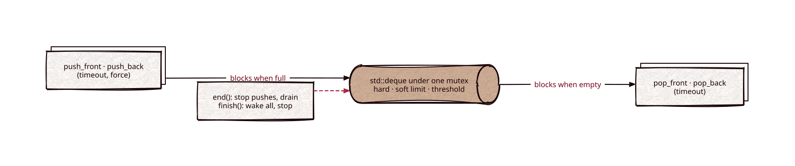

# queue

Part of [Kronuz C++ Libraries](https://github.com/Kronuz/cpp-libraries), a collection of small, reusable C++ libraries.

[](https://github.com/Kronuz/queue/actions/workflows/ci.yml)
[](LICENSE)


A thread-safe, bounded, blocking, double-ended queue for C++20: push and pop at
either end, wait with a per-call timeout, and shut down in two stages. For
hand-off channels between threads that need back-pressure and a clean shutdown.



## ✨ Highlights

- **Both ends.** `push_front`, `push_back`, `pop_front`, `pop_back`: FIFO, LIFO,
  or a priority lane at the front.
- **Timeouts on every call.** A negative timeout blocks, `0` never blocks, and a
  positive one waits that many seconds.
- **Back-pressure.** A hard limit blocks producers when full; a soft limit below
  it turns pushes away instead of blocking them.
- **Two-stage shutdown.** `end()` stops pushes and lets consumers drain;
  `finish()` wakes everyone and stops.
- **`QueueSet`**: the same queue with unique values and a duplicate policy.
- **Checked clean** under ASan and TSan with exactly-once accounting, and a
  liveness test for every change that can wake a waiting thread.

## 📦 Installation

Requires a C++20 compiler and threads; CMake 3.14 or newer for the CMake route. CI
builds it on Linux (x86_64, arm64), macOS (arm64, x86_64), and FreeBSD, plus ASan,
UBSan, and TSan builds.

```cmake
include(FetchContent)
FetchContent_Declare(queue
  GIT_REPOSITORY https://github.com/Kronuz/queue.git
  GIT_TAG        main)
FetchContent_MakeAvailable(queue)

target_link_libraries(my_app PRIVATE queue::queue)
```

Or copy `queue.h` onto your include path.

## 🚀 Quick start

```cpp
#include "queue.h"

#include <thread>

int main() {
	queue::Queue<int> q(/*hard_limit*/ 1024);

	std::thread consumer([&] {
		int v;
		while (q.pop_front(v)) { /* use v */ }   // false once ended and drained
	});

	for (int i = 0; i < 100; ++i) { q.push_back(i); }   // blocks if full
	q.end();                                             // stop pushes, let it drain
	consumer.join();
}
```

`q.pop_front(v, 0.05)` waits at most 50 ms; `q.pop_front(v, 0)` never waits.
[`examples/work_queue.cc`](examples/work_queue.cc) is a bounded worker queue in
the shape Xapiand uses.

## 🎯 When to use it

- ✅ A blocking channel that needs timeouts, both ends, a bound, or a clean
  shutdown.
- ❌ A caller that cannot take a lock, such as a signal handler or a real-time
  thread: every call locks one mutex.

## ⚡ Performance

`benchmark/bench.cc` times the single-ended MPMC path (`push_back` / `pop_front`): 2,000,000
items, best of 3, million items/sec, two runs each; producers x consumers.

Apple M4 Pro (arm64, Apple clang 17.0.0):

| | 1x1 | 2x2 | 4x4 | 8x8 |
|---|---|---|---|---|
| `queue::Queue<int>` | 41.4, 39.4 | 18.0, 19.8 | 20.0, 21.1 | 35.1, 34.0 |
| mutex+condvar+deque | 31.3, 31.6 | 18.9, 17.9 | 18.2, 18.4 | 18.5, 19.8 |
| moodycamel `BlockingConcurrentQueue` | 10.0, 9.6 | 5.8, 5.5 | 5.4, 6.0 | 5.5, 5.3 |

Intel i9-9980HK (x86_64, 8 cores / 16 threads, Apple clang 17.0.0):

| | 1x1 | 2x2 | 4x4 | 8x8 |
|---|---|---|---|---|
| `queue::Queue<int>` | 9.9, 9.0 | 6.7, 6.1 | 5.2, 4.7 | 3.7, 4.1 |
| mutex+condvar+deque | 8.2, 7.6 | 5.3, 5.0 | 3.9, 3.8 | 3.3, 3.4 |
| moodycamel `BlockingConcurrentQueue` | 8.5, 8.6 | 6.2, 6.4 | 10.0, 9.7 | 14.1, 13.3 |

On arm64 `Queue` is at parity with the baseline at 2x2 (0.95x to 1.1x), 1.1x to 1.3x at 1x1
and 4x4 and 1.7x to 1.9x at 8x8, and 3.1x to 6.4x moodycamel. On x86-64 it is 1.1x to 1.3x the
baseline at every shape and level with moodycamel at 1x1 and 2x2, but moodycamel is 1.9x to 2.1x
ahead at 4x4 and 3.2x to 3.8x ahead at 8x8: its lock-free design scales with the thread count and
every `Queue` call takes one mutex. The comparison covers only the shared subset: moodycamel has
no `pop_back`, no per-call deadline, and no `end()` or `finish()`. The hot operations are
force-inlined and decide the common case inline; as out-of-line calls they ran at 0.55x of the
baseline at 8x8 on x86-64 under Apple clang. See [CHANGELOG.md](CHANGELOG.md).

```sh
cmake -B build -DCMAKE_BUILD_TYPE=Release -DQUEUE_BUILD_BENCH=ON
cmake --build build --target queue_bench && ./build/queue_bench
```

`QUEUE_BUILD_BENCH` is off by default; it fetches cameron314/concurrentqueue (moodycamel) at a pinned
commit for the benchmark target only.

## 📚 Documentation

- [docs/API.md](docs/API.md): every call, its timeout rule, and `QueueSet`.
- [ARCHITECTURE.md](ARCHITECTURE.md): the state, the limits, the waits, and the
  shutdown model.
- [AGENTS.md](AGENTS.md): repository map, invariants, and traps.
- [CHANGELOG.md](CHANGELOG.md): what changed, with the earlier benchmark numbers.

## 🛠️ Building and testing

```sh
cmake -B build && cmake --build build && ctest --test-dir build
```

CTest runs the API tests, a many-producer, many-consumer stress test, a
differential test against a frozen copy of the header, the liveness tests (a
lost wake-up fails them within seconds instead of hanging), and the work-queue
example.

## 🤝 Contributing

Issues and pull requests are welcome. A change to `queue.h` reruns the stress test
under ASan and TSan; read [AGENTS.md](AGENTS.md) first. CI must pass on every
platform.

## 📄 License

MIT, Copyright (c) 2015-2019 Dubalu LLC. See [LICENSE](LICENSE). Extracted from
[Xapiand](https://github.com/Kronuz/Xapiand), where it feeds the thread pools and
the logger.
