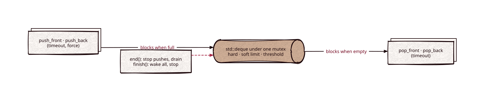

# queue

[](https://github.com/Kronuz/queue/actions/workflows/ci.yml)
[](LICENSE)


A thread-safe, bounded, blocking, double-ended queue for C++20: push and pop at
either end, wait with a per-call timeout, and shut down in two stages. For
hand-off channels between threads where back-pressure and a clean shutdown
matter more than raw throughput.



## ✨ Highlights

- **Both ends.** `push_front`, `push_back`, `pop_front`, `pop_back`: FIFO, LIFO,
  or a priority lane at the front.
- **Timeouts on every call.** A negative timeout blocks, `0` never blocks, and a
  positive one waits that many seconds.
- **Back-pressure.** A hard limit blocks producers when full; a soft limit and a
  wake threshold keep a near-full queue from thrashing.
- **Two-stage shutdown.** `end()` stops pushes and lets consumers drain;
  `finish()` wakes everyone and stops.
- **`QueueSet`**: the same queue with unique values and a duplicate policy.
- **Checked clean** under ASan and TSan with exactly-once accounting.

## 📦 Installation

Requires a C++20 compiler and threads; CMake 3.14 or newer for the CMake route. CI
builds it on Linux (x86_64, arm64), macOS (arm64, x86_64), and FreeBSD, plus ASan,
UBSan, and TSan builds.

```cmake
include(FetchContent)
FetchContent_Declare(queue
  GIT_REPOSITORY https://github.com/Kronuz/queue.git
  GIT_TAG        main)
FetchContent_MakeAvailable(queue)

target_link_libraries(my_app PRIVATE queue::queue)
```

Or copy `queue.h` onto your include path.

## 🚀 Quick start

```cpp
#include "queue.h"

#include <thread>

int main() {
	queue::Queue<int> q(/*hard_limit*/ 1024);

	std::thread consumer([&] {
		int v;
		while (q.pop_front(v)) { /* use v */ }   // false once ended and drained
	});

	for (int i = 0; i < 100; ++i) { q.push_back(i); }   // blocks if full
	q.end();                                             // stop pushes, let it drain
	consumer.join();
}
```

`q.pop_front(v, 0.05)` waits at most 50 ms; `q.pop_front(v, 0)` never waits.
[`examples/work_queue.cc`](examples/work_queue.cc) is a bounded worker queue in
the shape Xapiand uses.

## 🎯 When to use it

- ✅ A blocking channel that needs timeouts, both ends, a bound, or a clean
  shutdown.
- ❌ A raw single-ended throughput pipe: a plain mutex-and-deque queue, or a
  lock-free one, moves more items per second
  ([docs/PERFORMANCE.md](docs/PERFORMANCE.md)).

## 📚 Documentation

- [docs/API.md](docs/API.md): every call, its timeout rule, and `QueueSet`.
- [ARCHITECTURE.md](ARCHITECTURE.md): the state, the limits, the waits, and the
  shutdown model.
- [docs/PERFORMANCE.md](docs/PERFORMANCE.md): the sanitizer runs and the
  benchmark against a baseline and moodycamel.
- [AGENTS.md](AGENTS.md): repository map, invariants, and traps.

## 🛠️ Building and testing

```sh
cmake -B build && cmake --build build && ctest --test-dir build
```

CTest runs the API tests, a many-producer, many-consumer stress test, and the
work-queue example.

## 🤝 Contributing

Issues and pull requests are welcome. A change to `queue.h` reruns the stress test
under ASan and TSan; read [AGENTS.md](AGENTS.md) first. CI must pass on every
platform.

## 📄 License

MIT, Copyright (c) 2015-2019 Dubalu LLC. See [LICENSE](LICENSE). Extracted from
[Xapiand](https://github.com/Kronuz/Xapiand), where it feeds the thread pools and
the logger.
